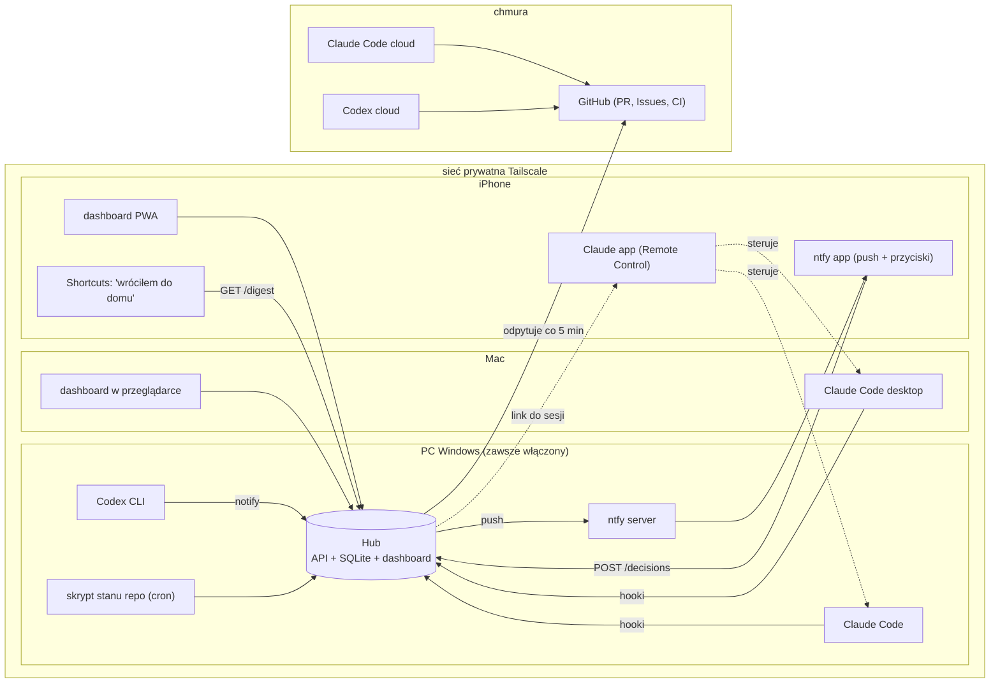

# Plan architektury: jeden panel sterowania dla wszystkich agentów

Stan: propozycja do dyskusji, 2026-11-08.
Zakres: Mac, PC z Windows, iPhone, Claude (Code + chmura), Codex (CLI + chmura).

---

## 1. Cel i cztery zasady

Cel: po wejściu do domu (albo z telefonu w drodze) widzisz w jednym miejscu
co robią agenci, co jest niedokończone w projektach i co czeka na Twoją decyzję.
Decyzję podejmujesz w tym samym miejscu, niezależnie od tego, na której maszynie
pracuje agent.

Zasady, które porządkują resztę dokumentu:

1. **Jedno źródło prawdy.** Istnieje jeden serwis (dalej: Hub), który trzyma
   stan projektów, sesji agentów i decyzji. Urządzenia i agenci są klientami Huba,
   nie równorzędnymi "kopiami prawdy".
2. **Agenci to robotnicy, nie panele.** Claude Code i Codex robią pracę.
   Nie budujesz w nich UI do zarządzania; one tylko raportują zdarzenia do Huba
   i odbierają z niego decyzje.
3. **Nie przebudowuj tego, co dostawca daje natywnie.** Sterowanie pojedynczą
   sesją Claude Code z telefonu już istnieje (Remote Control w aplikacji
   Claude na iOS). Codex ma odpowiednik w aplikacji ChatGPT. Hub nie zastępuje
   tych narzędzi; Hub je spina i dodaje warstwę, której żaden z dostawców nie da:
   widok między-dostawcowy, kolejkę decyzji i stan projektów.
4. **Kalendarz to wyjście, nie baza danych.** Apple Calendar i Reminders dostają
   dane z Huba (terminy, rytuał przeglądu), ale nigdy nie są miejscem, gdzie
   agent "sprawdza co ma robić". Szczegóły w sekcji 8.

---

## 2. Mapa urządzeń i ról

| Urządzenie | Rola | Co na nim działa | Czy musi być włączone |
|---|---|---|---|
| PC Windows | **Serwer roboczy + Hub** | Agenci (Claude Code, Codex CLI), środowiska buildowe, Hub, dashboard | Tak, zawsze (bez usypiania) |
| Mac | **Stacja decyzyjna + robotnik mobilny** | Claude Code desktop, sesje lokalne, dashboard w przeglądarce | Nie |
| iPhone | **Pilot** | Powiadomienia, dashboard jako PWA, Remote Control Claude, Shortcuts | Nie |
| Chmura Anthropic | Robotnik | Sesje Claude Code w chmurze (branch → PR) | n/d |
| Chmura OpenAI | Robotnik | Zadania Codex w chmurze (branch → PR) | n/d |
| GitHub | **Stan projektów kodowych** | Repozytoria, PR-y, Issues/Projects, odpytywane przez Hub | n/d |

Hub zaczyna na PC z Windows, bo i tak musi być włączony. Jeśli kiedyś zechcesz,
żeby panel żył także gdy PC jest wyłączony, przenosisz Hub na mały VPS
(Hetzner/Fly, kilka euro miesięcznie). Projektujemy tak, żeby ta przeprowadzka
była zmianą jednej zmiennej (`HUB_URL`), nie przepisaniem.

---

## 3. Warstwy architektury

```
┌───────────────────────────────────────────────────────────────────────┐
│  WARSTWA 5: INTERFEJS DECYZYJNY                                       │
│  Dashboard (PWA) · powiadomienia ntfy z przyciskami · Shortcuts iOS    │
├───────────────────────────────────────────────────────────────────────┤
│  WARSTWA 4: HUB (control plane)                                        │
│  API zdarzeń · kolejka decyzji · stan projektów · digest · SQLite      │
├───────────────────────────────────────────────────────────────────────┤
│  WARSTWA 3: ADAPTERY AGENTÓW                                           │
│  hooki Claude Code · notify Codex · odpyt. GitHub · skrypt "stan repo" │
├───────────────────────────────────────────────────────────────────────┤
│  WARSTWA 2: ROBOTNICY                                                  │
│  Claude Code (Mac, Win, chmura) · Codex (Win CLI, chmura)              │
├───────────────────────────────────────────────────────────────────────┤
│  WARSTWA 1: SIEĆ I DOSTĘP                                              │
│  Tailscale (wszystkie urządzenia) · RDP/SSH do Windows · Remote Control│
└───────────────────────────────────────────────────────────────────────┘
```

### Warstwa 1: sieć (Tailscale)

Wszystkie urządzenia w jednej prywatnej sieci Tailscale. Dzięki temu:

- iPhone i Mac widzą Hub na PC pod stałym adresem, bez otwierania portów
  na routerze i bez wystawiania czegokolwiek do internetu.
- Zdalny pulpit Windows (RDP) i SSH działają z dowolnego miejsca.
- Na Windows użyj wbudowanego OpenSSH Server (Tailscale SSH jako serwer działa
  tylko na Linux/macOS), a RDP zostaw na adresie Tailscale.
- Na iPhone Tailscale działa jako VPN na żądanie; włącza się sam, gdy
  otwierasz dashboard.

### Warstwa 2: robotnicy

Bez zmian w tym, jak pracujesz. Jedyna reguła: każdy agent uruchamiasz
w kontekście projektu (katalog = repo), żeby zdarzenia dało się przypisać.

### Warstwa 3: adaptery (jak agenci mówią do Huba)

| Źródło | Mechanizm | Zdarzenia |
|---|---|---|
| Claude Code (Mac, Win) | Hooki w `settings.json`: `SessionStart`, `Stop`, `Notification`, `PreToolUse`, `SessionEnd` | start/koniec sesji, "czekam na Ciebie", prośba o zgodę, koniec tury |
| Codex CLI (Win) | `notify` w `~/.codex/config.toml` (uruchamia skrypt z JSON) | koniec tury, prośba o zgodę |
| Claude chmura, Codex chmura | Hub odpytuje API GitHub co 5 min (`gh`); webhook nie dotrze do Huba w sieci prywatnej | nowy PR, CI czerwone, komentarz |
| Repozytoria lokalne | Skrypt cron co 15 min: `git status` + `gh pr list` w każdym repo | niezacommitowane zmiany, branch bez PR, PR bez review |

Każdy adapter to kilkunastolinijkowy skrypt, który robi `POST $HUB_URL/events`
z tokenem. Wspólny format zdarzenia:

```json
{
  "ts": "2026-11-08T18:42:00Z",
  "source": "claude-code",          
  "machine": "win-pc",
  "project": "integrate-systems",   
  "session": "abc123",
  "type": "needs_decision",         
  "title": "Zgoda na: rm -rf build/",
  "payload": { "tool": "Bash", "command": "rm -rf build/" },
  "reply_to": "http://win-pc:7777/decisions/abc123"  
}
```

Typy zdarzeń (celowo mało): `session_started`, `turn_finished`,
`needs_decision`, `blocked`, `pr_opened`, `ci_failed`, `repo_dirty`,
`session_ended`.

### Warstwa 4: Hub

Jeden proces, jedna baza SQLite, zero zewnętrznych zależności.
Proponowany stos: TypeScript + Hono + better-sqlite3 + HTML renderowane po
stronie serwera z SSE do odświeżania na żywo. Alternatywa równie dobra:
Python + FastAPI. Wybierz to, co szybciej napisze Ci agent.

Odpowiedzialności:

- **Ingest**: przyjmuje zdarzenia, zapisuje, deduplikuje.
- **Kolejka decyzji**: każde `needs_decision` staje się wierszem
  `pending` → po Twojej odpowiedzi `approved`/`rejected` + wywołanie `reply_to`.
- **Stan projektów**: łączy GitHub (PR-y, issues) ze stanem lokalnym
  (`repo_dirty`) w jedną listę "niedokończone".
- **Digest**: na żądanie (lub o stałej porze) buduje podsumowanie:
  co się skończyło, co czeka, co jest brudne.
- **Powiadomienia**: dla `needs_decision`, `blocked`, `ci_failed` wysyła push
  przez ntfy; reszta tylko do dashboardu.

Model danych (minimum):

```
projects   (id, name, repo, machine_default, last_activity)
sessions   (id, project_id, source, machine, started, ended, status)
events     (id, session_id, ts, type, title, payload_json)
decisions  (id, event_id, question, options_json, status, reply_to, answered_at)
unfinished (project_id, kind, ref, since)   -- widok, nie tabela
```

### Warstwa 5: interfejs decyzyjny

Trzy drzwi do tego samego Huba:

1. **Dashboard (PWA)**. Jedna strona, trzy kolumny: *Decyzje* (do kliknięcia),
   *Agenci teraz* (per maszyna, z linkiem do Remote Control), *Niedokończone*
   (per projekt). Dodajesz do ekranu głównego iPhone'a; na Macu zakładka.
2. **Powiadomienia ntfy** z przyciskami. ntfy (aplikacja iOS + mały serwer,
   może stać na tym samym PC) wysyła push z akcjami `Zatwierdź` / `Odrzuć`,
   które robią `POST` do Huba. Decyzja z ekranu blokady, bez otwierania czegokolwiek.
3. **Remote Control / aplikacja dostawcy**, gdy decyzja wymaga rozmowy z agentem,
   a nie jednego kliknięcia. Dashboard tylko linkuje do właściwej sesji.

---

## 4. Diagram połączeń



---

## 5. Przepływy komunikacji (cztery scenariusze)

### A. Agent skończył turę

1. Claude Code na Windows kończy → hook `Stop` robi `POST /events`
   (`turn_finished`, ostatnie 500 znaków odpowiedzi w `payload`).
2. Hub zapisuje, oznacza sesję jako `idle`, aktualizuje kolumnę *Agenci teraz*.
3. Brak pusha (to nie jest pilne). Zobaczysz to w digeście albo na dashboardzie.

### B. Agent potrzebuje decyzji (jesteś poza domem)

1. Hook `PreToolUse` na komendę z listy "niebezpieczne" (np. `rm`, `git push --force`,
   `DROP`) wysyła `needs_decision` i **czeka** na odpowiedź Huba
   (polling co 2 s, limit np. 10 min; hook ma ustawiony odpowiedni `timeout`).
2. Hub tworzy `decision`, wysyła push przez ntfy z dwoma przyciskami.
3. Klikasz `Zatwierdź` na ekranie blokady → ntfy robi `POST /decisions/:id`
   (przez Tailscale VPN na żądanie).
4. Hook dostaje `approved`, zwraca Claude Code `permissionDecision: allow`.
   Agent jedzie dalej. Przy `rejected` albo timeout: `deny` z powodem, agent
   pisze, co by zrobił inaczej, i czeka.

Uwaga praktyczna: bramkę zgód stosuj tylko do krótkiej listy operacji.
Reszta zgód zostaje w normalnym trybie uprawnień Claude Code; inaczej
telefon będzie brzęczał co 30 sekund.

### C. Chcesz porozmawiać z agentem, nie tylko kliknąć

1. Dashboard przy sesji pokazuje przycisk *Otwórz w Claude* (deep link do
   sesji z Remote Control) albo *Otwórz w ChatGPT* dla Codexa.
2. Rozmawiasz w aplikacji dostawcy. Hub nie pośredniczy; dostaje tylko
   zdarzenia `turn_finished` jak zwykle.
3. Jeśli trzeba czegoś poza agentem (restart serwisu, zajrzeć w pliki):
   RDP lub SSH do PC przez Tailscale.

### D. Wracasz do domu

1. Shortcuts na iPhone: automatyzacja *Przyjazd: dom* → `GET /digest`
   → pokazuje powiadomienie z trzema liczbami (decyzje / agenci aktywni /
   niedokończone) i otwiera PWA.
2. Na Macu dashboard i tak jest otwarty; nic nie trzeba robić.
3. Opcjonalnie Hub co wieczór dopisuje do Reminders rzeczy z terminem
   (sekcja 8).

---

## 6. Co lokalnie, co w chmurze

| Rzecz | Gdzie | Dlaczego |
|---|---|---|
| Hub + baza | Lokalnie (PC Windows), w Tailscale | Zero kosztu, dane u Ciebie, PC i tak włączony |
| ntfy | Lokalnie na PC (docker) lub ntfy.sh hostowane | Lokalnie: prywatność; ntfy.sh: zero utrzymania |
| Ciężka praca agentów | PC Windows (środowiska już są) | Jak dziś |
| Praca "odpal i zapomnij" | Claude cloud / Codex cloud | Nie zależy od żadnej Twojej maszyny; wynik ląduje jako PR |
| Stan projektów kodowych | GitHub | Obaj dostawcy chmurowi już tam piszą; nie dubluj |
| Sterowanie sesją z telefonu | Remote Control (Anthropic) / app ChatGPT | Nie da się tego lepiej zrobić samemu |

Reguła podziału: jeśli zadanie ma jasny opis i kończy się PR-em, idzie do
chmury. Jeśli wymaga lokalnego środowiska, danych albo wielu tur rozmowy,
idzie na PC. Hub widzi oba tak samo.

---

## 7. Bezpieczeństwo

- Hub nasłuchuje wyłącznie na adresie Tailscale, nigdy na `0.0.0.0`.
- Każdy adapter ma własny token Bearer; Hub loguje, kto wysłał zdarzenie.
- Endpoint decyzji przyjmuje tylko `approved`/`rejected` dla istniejącego
  `id` w stanie `pending`; nie ma endpointu "wykonaj komendę".
- RDP i SSH tylko przez Tailscale; na routerze nic nie otwierasz.
- PreToolUse-gateway domyślnie odrzuca po timeoucie (fail-closed).
- Tokeny trzymasz w menedżerze haseł, nie w repo.

---

## 8. Kalendarz i Reminders: czy integrować

Krótko: tak, ale tylko jako **wyjście** z Huba i tylko dla rzeczy z datą.

Dlaczego nie jako źródło prawdy:

- Kalendarz nie ma pojęcia "stan sesji agenta" ani "PR czeka na review".
  Wciskanie tego w wydarzenia daje kalendarz pełen śmieci.
- Z Windows pisanie do iCloud to CalDAV z hasłem aplikacji; da się, ale to
  najbardziej kruchy element w całym systemie.
- Agent czytający kalendarz, żeby wiedzieć co robić, to zaproszenie do
  wstrzykiwania instrukcji przez zaproszenia.

Co ma sens:

- **Reminders** dla rzeczy z terminem: Hub → skrypt na Macu
  (`reminders-cli` lub AppleScript) albo Shortcut na iPhone, raz dziennie,
  tylko dla elementów oznaczonych `due`. Jednokierunkowo.
- **Calendar** dla rytuału: stały blok *Przegląd agentów* (np. 18:30, 15 min),
  z linkiem do dashboardu w notatce. To jest "wchodzę do domu" w formie,
  którą kalendarz rozumie.
- **Shortcuts** jako klej: automatyzacje lokalizacyjne i czasowe wołają
  Hub; to jest tańsze i pewniejsze niż jakakolwiek integracja z EventKit.

---

## 9. Fazy wdrożenia

### Faza 0 (jeden wieczór): widoczność bez Huba
- Tailscale na Mac, PC, iPhone. RDP + OpenSSH na Windows.
- ntfy (app na iPhone + ntfy.sh lub docker na PC).
- Hooki `Notification` i `Stop` w Claude Code na obu maszynach → `curl` do ntfy.
- `notify` w Codex → ten sam skrypt.
- Włącz Remote Control w Claude Code desktop.
- Efekt: push na telefon, gdy jakikolwiek agent czeka, i możliwość
  przejęcia sesji Claude z telefonu.

### Faza 1 (weekend): Hub i dashboard
- Hub na PC: ingest, SQLite, dashboard z trzema kolumnami, `/digest`.
- Adaptery przekierowane z ntfy na Hub; Hub sam decyduje, co pchać do ntfy.
- Skrypt stanu repo (cron co 15 min na PC i na Macu).
- Shortcut *Przyjazd: dom* → `/digest`.

### Faza 2: decyzje z telefonu
- Tabela `decisions`, przyciski w ntfy, `PreToolUse`-gateway z krótką listą
  komend wymagających zgody.
- Linki do Remote Control przy sesjach na dashboardzie.

### Faza 3: projekty i chmura
- Hub odpytuje GitHub co 5 min (PR, CI, review).
- Widok *Niedokończone* łączący GitHub i stan lokalny.
- Sync `due` → Reminders. Blok *Przegląd agentów* w Calendar.

### Faza 4 (opcjonalnie): niezależność od PC
- Hub + ntfy na VPS. Zmiana `HUB_URL` w adapterach. Reszta bez zmian.

Każdą fazę może napisać Claude Code w tym katalogu; ten dokument jest
wystarczającą specyfikacją dla fazy 0 i 1.

---

## 10. Trzy decyzje do podjęcia przed startem

1. **Hub na PC czy od razu na VPS?** Rekomendacja: PC. Przeprowadzka później
   jest tania, a dziś oszczędzasz tydzień konfiguracji.
2. **ntfy.sh (hostowane) czy własny ntfy na PC?** Rekomendacja: ntfy.sh na
   start z losowym, długim tematem; własny, gdy treść powiadomień zacznie
   zawierać fragmenty kodu klientów.
3. **Stos Huba: TypeScript czy Python?** Rekomendacja: TypeScript (Hono +
   better-sqlite3), bo dashboard i SSE wychodzą naturalnie. Bez znaczenia
   dla architektury.
